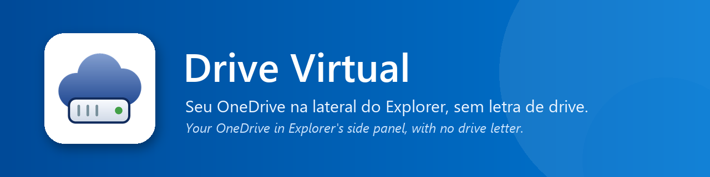
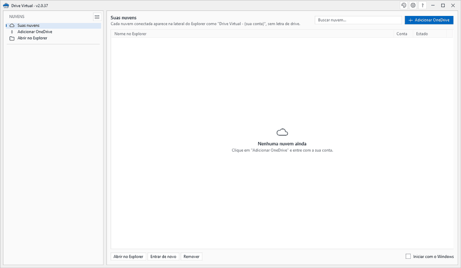
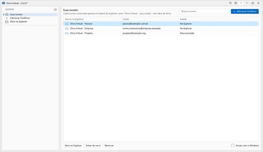
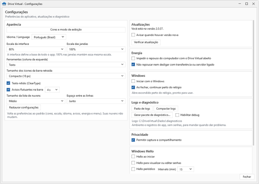
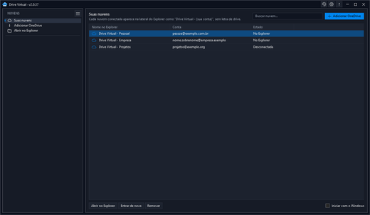
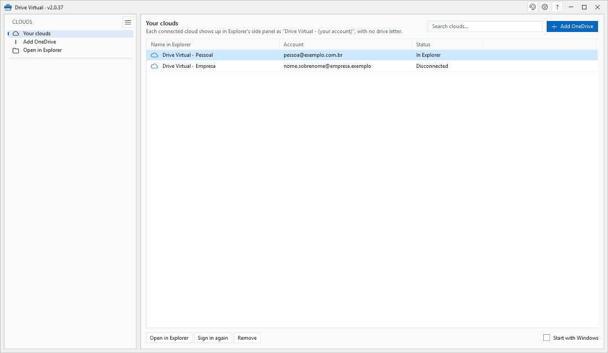
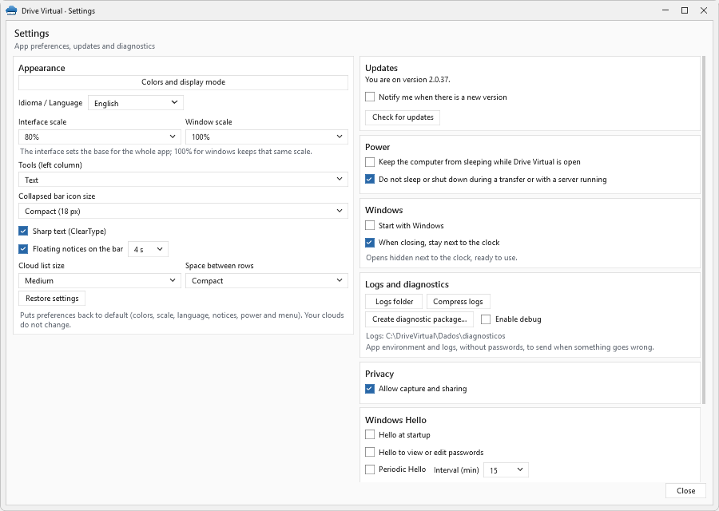

   

<b>Seu OneDrive na lateral do Explorer, como o oficial, sem letra de drive.</b> <i>Your OneDrive in Explorer's side panel, like the official one, with no drive letter.</i>

## O que é / What it is
O Drive Virtual coloca cada conta do OneDrive na lateral do Explorer do Windows, com os arquivos baixando só quando você abre. Serve para quem não pode usar o OneDrive oficial ou precisa de várias contas ao mesmo tempo. Fala direto com a Microsoft; a senha fica só com ela.
*Drive Virtual puts each OneDrive account in Windows Explorer's side panel, downloading files only when you open them. It is for people who can't use the official OneDrive or need several accounts at once. It talks straight to Microsoft; your password stays with Microsoft.*

## Destaques / Highlights
| | |
|---|---|
| **Várias contas, lado a lado** — pessoal, trabalho e projetos, cada uma com seu nome no Explorer. *Several accounts side by side — personal, work and projects, each with its own name in Explorer.* |  |
| **Sem administrador, atualiza sozinho** — instalador só para você ou versão portátil; o app avisa e instala a versão nova. *No admin rights, updates itself — per-user installer or portable; the app tells you and installs the new version.* |  |
| **Claro, escuro ou do Windows** — o visual acompanha o seu gosto, perto do relógio e na janela. *Light, dark or follow Windows — the look follows your choice, next to the clock and in the window.* |  |

## Como funciona / How it works
1. Instale o .msi ou descompacte o portátil e abra o Drive Virtual. / *Install the .msi or unzip the portable version and open Drive Virtual.*
2. Clique em **Adicionar OneDrive** e entre com a sua conta na janela anônima do navegador. / *Click **Add OneDrive** and sign in with your account in the browser's private window.*
3. Pronto: a nuvem aparece na lateral do Explorer; o que você grava ali sobe sozinho. / *Done: the cloud shows up in Explorer's side panel; whatever you save there uploads by itself.*

## Funcionalidades / Features
| Recurso / Feature | O que faz / What it does |
|---|---|
| Lateral do Explorer | Cada conta vira "Drive Virtual - (sua conta)", sem letra de drive. / *Each account becomes "Drive Virtual - (your account)", no drive letter.* |
| Arquivos sob demanda | Baixam ao abrir; "Sempre manter neste dispositivo" e "Liberar espaço" no botão direito. / *Download on open; "Always keep on this device" and "Free up space" on right-click.* |
| Ícone perto do relógio | Mostra se está enviando, baixando, sem internet ou precisando entrar de novo. / *Shows uploading, downloading, offline or sign-in needed.* |
| Iniciar com o Windows | Abre escondido perto do relógio, sem pedir administrador. / *Starts hidden next to the clock, no admin rights.* |
| Windows Hello | Pode pedir o Hello para abrir a janela e as senhas. / *Can ask for Hello to open the window and passwords.* |
| Português e inglês | Troque o idioma em Configurações. / *Switch the language in Settings.* |

## Galeria / Gallery
| | |
|---|---|
|  Janela principal com as nuvens / *Main window with the clouds* |  Modo escuro / *Dark mode* |
|  Configurações: aparência, atualizações, energia, Windows / *Settings* |  Aparência: claro, escuro ou seguir o Windows / *Appearance* |
|  Em inglês / *In English* |  Settings in English / *Configurações em inglês* |

## Baixar / Download
- [Instalador e portátil — versão mais nova / Installer and portable — latest version](https://github.com/Dorflex-DD/DriveVirtual-releases/releases/latest)

Windows 10/11 x64 · .NET 10 Desktop Runtime x64

## Novidades / What's new — v2.0.37
- Escala padrão da interface em 80%; suas escolhas salvas continuam. / *Default interface scale is now 80%; your saved choices are kept.*
- Os dados do app ficam dentro da pasta dele, na pasta Dados. / *App data now lives inside its own folder, in the Dados folder.*
- Desinstalar mais cuidadoso: nada se perde se o app não fechar. / *Safer uninstall: nothing is lost if the app doesn't close.*

Uso somente com autorização escrita do autor. Este repositório não contém código-fonte. / Use only with the author's written authorization. This repository holds no source code.
