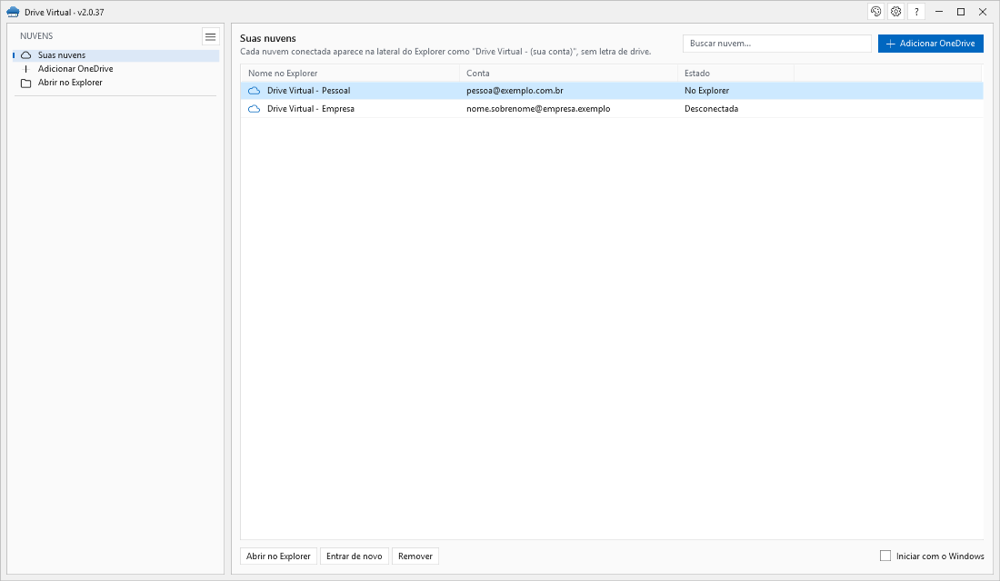
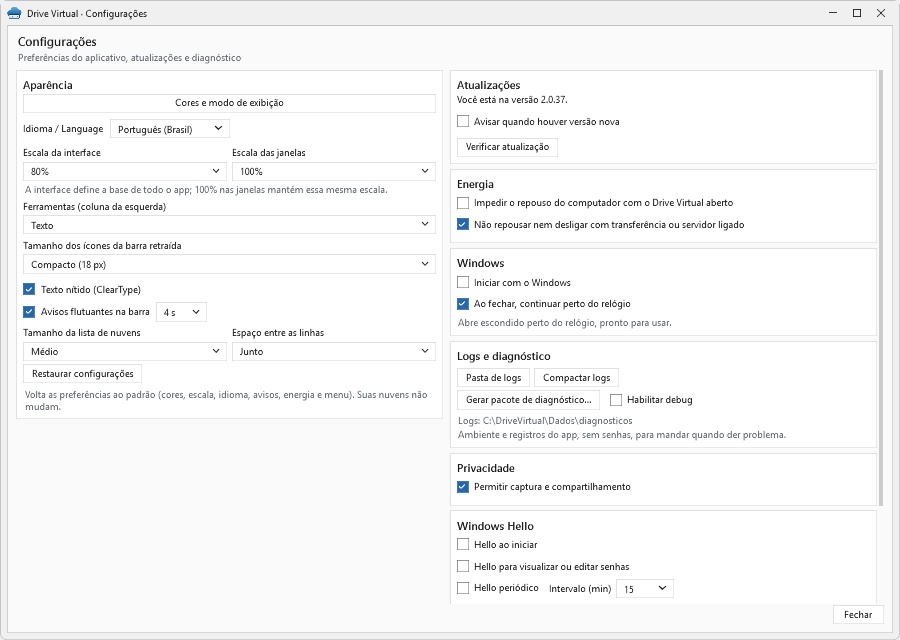
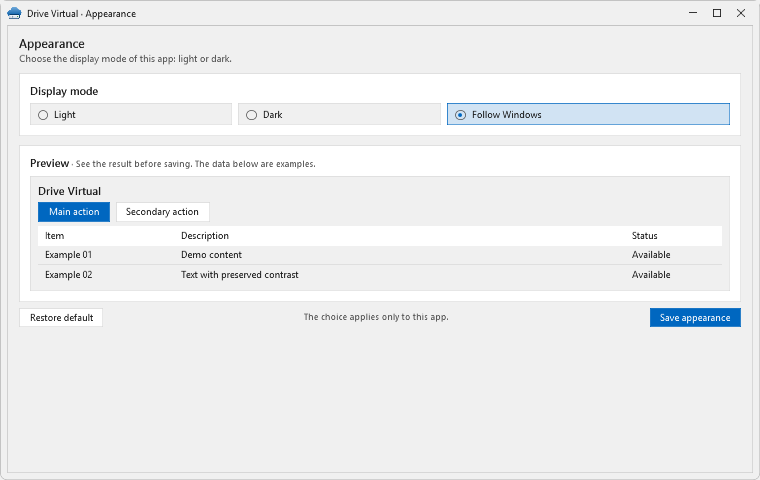

# Drive Virtual

**PT** — Distribuição oficial do Drive Virtual para Windows: pacote portátil (.zip) e instalador (.msi), com as notas de cada versão. Baixe na aba [Releases](https://github.com/Dorflex-DD/DriveVirtual-releases/releases). Este repositório não contém código-fonte. Os mesmos pacotes estão no GitLab: https://gitlab.com/fabioffg/DriveVirtual/-/releases

**EN** — Official Windows distribution of Drive Virtual: portable package (.zip) and installer (.msi), with release notes. Download from the [Releases](https://github.com/Dorflex-DD/DriveVirtual-releases/releases) tab. This repository holds no source code. The same packages are on GitLab: https://gitlab.com/fabioffg/DriveVirtual/-/releases

## Telas / Screens (v2.0.37)

**PT** — Janela principal com as nuvens conectadas (dados fictícios), Configurações e Aparência.
**EN** — Main window with connected clouds (sample data), Settings and Appearance.

| Português | English |
|---|---|
|  |  |
|  |  |
|  |  |
